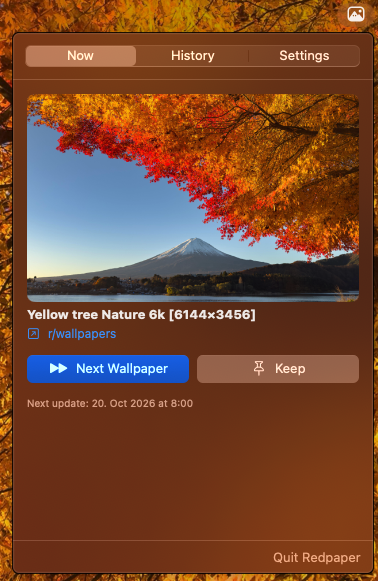
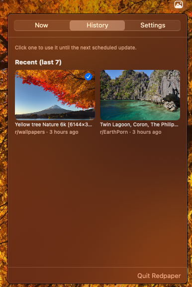
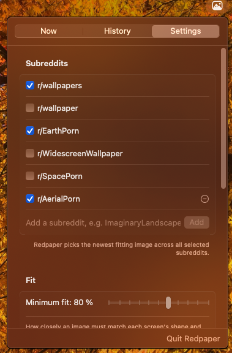
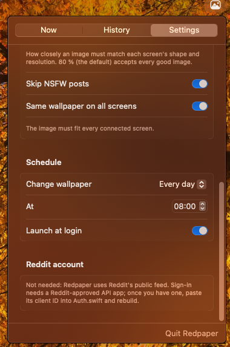

<p align="center">
  
</p>

<h1 align="center">Redpaper</h1>

<p align="center">
  Fresh wallpapers from Reddit, automatically, on every screen.<br>
  A small macOS menu bar app. No account, no API key, no dependencies.
</p>

---

Redpaper picks the newest image from your favourite subreddits that actually **fits your screen**,
and sets it as your wallpaper on a schedule you choose. Images that are too small or the wrong
shape are skipped, so you won't get a blurry or awkwardly cropped desktop.

<p align="center">
  &nbsp;&nbsp;
</p>
<p align="center">
  &nbsp;&nbsp;
</p>

## Features

- **Fits your screens.** Each image gets a fit score based on its shape and resolution. Only images that
  look good on _your_ displays are used, including MacBook 16:10 screens and ultrawides.
- **Multiple monitors.** Use the same wallpaper everywhere, or let each screen get its own best match.
- **Your subreddits.** Comes with r/wallpapers, r/wallpaper, r/EarthPorn, r/WidescreenWallpaper and
  r/SpacePorn. You can add any other subreddit, and Redpaper takes turns between the ones you select.
- **Schedule.** Every hour, every 6 hours, daily or weekly at a set time, or only when you ask.
  If your Mac was asleep at that time, Redpaper catches up when it wakes.
- **Next and Keep.** Don't like it? Press **Next**. Love it? Press **Keep** to save it and pause the schedule.
- **History.** Go back to any of your last 7 wallpapers, or to the ones you kept, with one click.
- **Never repeats.** Images you've already seen or skipped don't come back.
- **Skips NSFW posts** (on by default).
- **Update notices.** When a new version is released, the popup tells you, with a link to what's new.
  Or check any time with **Settings → Check Now**.
- **Light.** Redpaper uses Reddit's public feed and caches it, so it only sends a request now and then.
  Old images are deleted automatically.

## Requirements

- macOS 14 Sonoma or later
- Apple's Command Line Tools (free). If you don't have them yet, install them with:

  ```sh
  xcode-select --install
  ```

  Full Xcode works too, but you don't need it.

## Install

```sh
git clone https://github.com/WsMonty/Redpaper.git
cd Redpaper
./deploy.sh
```

`deploy.sh` builds the app, copies it to `/Applications`, and starts it. Run it again whenever you
pull updates. It replaces the installed copy and restarts it.

Redpaper has no Dock icon. Look for the **framed mountain** icon in the menu bar. It sets your first
wallpaper right away.

> **Can't see the icon?** On a MacBook with a notch, menu bar icons can hide behind the camera when the
> menu bar is full. Quit a few other menu bar apps, or check **System Settings → Menu Bar** to make sure
> Redpaper is allowed to appear there.

To start Redpaper automatically, open the popup and turn on **Settings → Launch at login**.

Only want to build it? Run `./build.sh` and you'll find the app in `build/Redpaper.app`.

## Using it

Click the menu bar icon:

| Tab          | What it's for                                                                                                 |
| ------------ | ------------------------------------------------------------------------------------------------------------- |
| **Now**      | The current wallpaper with a link to the Reddit post, **Next**, **Keep**, and the time of the next update.    |
| **History**  | Your last 7 wallpapers and the ones you kept. Click one to use it again. Right-click a kept one to remove it. |
| **Settings** | Subreddits, minimum fit, NSFW filter, multiple screens, schedule, launch at login and update checks.          |

Keyboard shortcuts while the popup is open: **⌘N** for the next wallpaper, **⌘Q** to quit.

### About "fit"

For every screen, Redpaper compares the image to the screen in two ways:

- **Shape:** how close the image's aspect ratio is to the screen's.
- **Resolution:** whether the image has at least as many pixels as the screen.

The fit is the lower of the two. The default minimum, **80 %**, accepts every good 16:9, 16:10 or 3:2
image on common screens. If you raise it, fewer images will qualify. On a MacBook, most 16:9 wallpapers
top out at about 87 %.

### About Reddit's rate limit

Without an account, Reddit allows about one request per minute. Redpaper caches what it fetched, so
**Next** usually doesn't need a new request. If it does have to wait, the popup shows a countdown.

## Good to know

- **Spaces.** macOS only lets apps set the wallpaper of the Space you're currently on. Redpaper applies
  the wallpaper again whenever you switch to another Space, so every Space ends up with it.
- **Where files go.** Images are saved in `~/Library/Application Support/Redpaper/`. Only the ones on
  screen, in your history, or kept are stored there. Everything else is deleted.
- **Privacy.** Redpaper only talks to `reddit.com` and `i.redd.it`, plus `api.github.com` once a day to
  check for a new version (turn this off in **Settings → Check for updates**). No analytics, no tracking.

## Uninstall

1. Click the menu bar icon and choose **Quit Redpaper**. If you turned on Launch at login, turn it off first.
2. Delete `/Applications/Redpaper.app`.
3. Optionally delete the downloaded images and settings:

   ```sh
   rm -rf ~/Library/Application\ Support/Redpaper
   defaults delete local.Redpaper
   ```

## For developers

```bash
Sources/Redpaper/
  App.swift           App entry, scheduler, and the update logic
  PopupView.swift     The menu bar popup (Now and History tabs)
  SettingsView.swift  The Settings tab
  Reddit.swift        Fetching and parsing posts (RSS and JSON), fit score
  Wallpaper.swift     Download, size probing, setting the wallpaper, thumbnails
  Auth.swift          Optional Reddit sign-in (OAuth), with tokens in the Keychain
icon/                 App icon (regenerate with: swift icon/make_icon.swift)
build.sh              Builds build/Redpaper.app
deploy.sh             Builds, installs to /Applications, and restarts the app
```

Run the built-in checks (fit math, feed parsing, schedule):

```sh
./build.sh && build/Redpaper.app/Contents/MacOS/Redpaper --selftest
```

**Releasing a version.** The app's version is the latest git tag, and installed copies compare it with
the newest GitHub release. To ship one, tag it and publish a release:

```sh
git tag v1.1 && git push origin v1.1
gh release create v1.1 --generate-notes
```

**Reddit sign-in (optional).** By default Redpaper uses Reddit's public feed, which needs no account.
If you have an approved Reddit API app (type _installed app_, redirect URI `redpaper://auth`), paste its
client ID into `Auth.swift` and rebuild. You'll then see a sign-in button in Settings. Signing in removes
the one-request-per-minute wait and gives exact image sizes and NSFW flags.

## License

[MIT](LICENSE)
