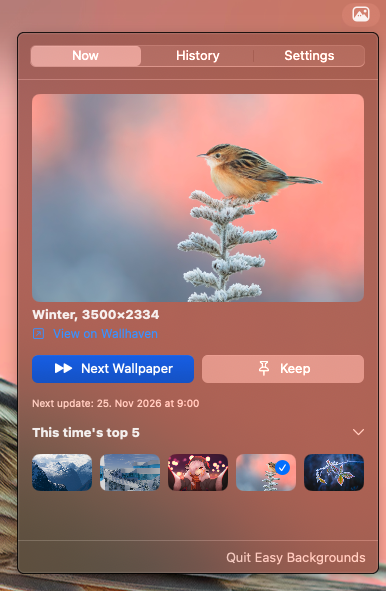
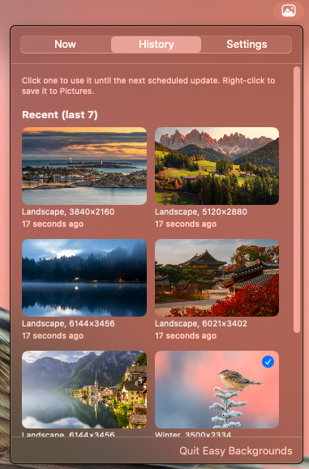
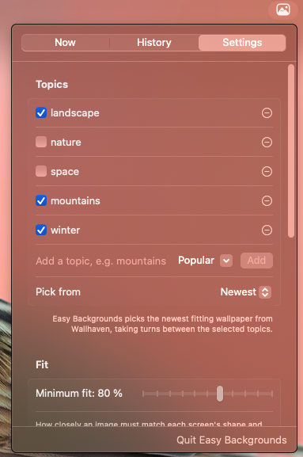
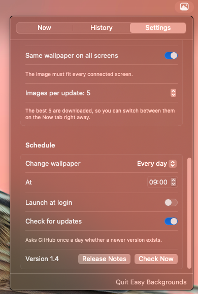

<p align="center">
  
</p>

<h1 align="center">Easy Backgrounds</h1>

<p align="center">
  Fresh wallpapers from Wallhaven, automatically, on every screen.<br>
  A small macOS menu bar app. No account, no API key, no dependencies.
</p>

---

Easy Backgrounds picks the newest (or most popular) wallpaper on the topics you like that actually **fits your screen**,
and sets it as your wallpaper on a schedule you choose. Images that are too small or the wrong
shape are skipped, so you won't get a blurry or awkwardly cropped desktop.

Formerly **Redpaper**, which used Reddit until Reddit closed its public feeds in November 2026.

<p align="center">
  &nbsp;&nbsp;
</p>
<p align="center">
  &nbsp;&nbsp;
</p>

## Features

- **Fits your screens.** Each image gets a fit score based on its shape and resolution. Only images that
  look good on _your_ displays are used, including MacBook 16:10 screens and ultrawides.
- **Multiple monitors.** Use the same wallpaper everywhere, or let each screen get its own best match.
- **Your topics.** Starts with landscape, nature and space. Add more from a list of 50 popular topics,
  or type your own (anything you'd search for on Wallhaven). Easy Backgrounds takes turns between the ones you select.
- **Newest or top.** Pick from the newest wallpapers, or the most popular of the month, year or all time.
- **Schedule.** Every hour, every 6 hours, daily or weekly at a set time, or only when you ask.
  If your Mac was asleep at that time, Easy Backgrounds catches up when it wakes.
- **Next and Keep.** Don't like it? Press **Next**. Love it? Press **Keep** to save it and pause the schedule.
- **History.** Go back to any of your last 7 wallpapers, or to the ones you kept, with one click.
  Right-click one to show it in Finder or save a copy to `~/Pictures/Easy Backgrounds`.
- **Never repeats.** Images you've already seen or skipped don't come back.
- **Safe for work only.** Only Wallhaven's SFW wallpapers are used.
- **Update notices.** When a new version is released, the popup tells you, with a link to what's new.
  Or check any time with **Settings → Check Now**.
- **Light.** Easy Backgrounds caches search results, so it only sends a request now and then.
  Old images are deleted automatically.

## Requirements

- macOS 14 Sonoma or later
- Apple's Command Line Tools (free). If you don't have them yet, install them with:

  ```sh
  xcode-select --install
  ```

  Full Xcode works too, but you don't need it.

## Install

```sh
git clone https://github.com/WsMonty/easy-backgrounds.git
cd easy-backgrounds
./deploy.sh
```

`deploy.sh` builds the app, copies it to `/Applications`, and starts it. Run it again whenever you
pull updates. It replaces the installed copy and restarts it.

Easy Backgrounds has no Dock icon. Look for the **framed mountain** icon in the menu bar. It sets your first
wallpaper right away.

> **Can't see the icon?** On a MacBook with a notch, menu bar icons can hide behind the camera when the
> menu bar is full. Quit a few other menu bar apps, or check **System Settings → Menu Bar** to make sure
> Easy Backgrounds is allowed to appear there.

To start Easy Backgrounds automatically, open the popup and turn on **Settings → Launch at login**.

Only want to build it? Run `./build.sh` and you'll find the app in `build/Easy Backgrounds.app`.

> **Coming from Redpaper?** Quit Redpaper (turn off its Launch at login first) and delete
> `/Applications/Redpaper.app`. Settings and history don't carry over.

## Using it

Click the menu bar icon:

| Tab          | What it's for                                                                                                 |
| ------------ | ------------------------------------------------------------------------------------------------------------- |
| **Now**      | The current wallpaper with a link to it on Wallhaven, **Next**, **Keep**, and the time of the next update.    |
| **History**  | Your last 7 wallpapers and the ones you kept. Click one to use it again. Right-click to show in Finder, save to Pictures, or remove from Kept. |
| **Settings** | Topics, newest or top, minimum fit, multiple screens, schedule, launch at login and update checks.          |

Keyboard shortcuts while the popup is open: **⌘N** for the next wallpaper, **⌘Q** to quit.

### About "fit"

For every screen, Easy Backgrounds compares the image to the screen in two ways:

- **Shape:** how close the image's aspect ratio is to the screen's.
- **Resolution:** whether the image has at least as many pixels as the screen.

The fit is the lower of the two. The default minimum, **80 %**, accepts every good 16:9, 16:10 or 3:2
image on common screens. If you raise it, fewer images will qualify. On a MacBook, most 16:9 wallpapers
top out at about 87 %.

### About Wallhaven

Wallpapers come from [wallhaven.cc](https://wallhaven.cc) through its free public API (no account or key
needed). It allows 45 requests a minute, far more than Easy Backgrounds needs. If it ever has to wait,
the popup shows a countdown. All images remain the property of their creators; the Now tab links to each
one's Wallhaven page.

## Good to know

- **Spaces.** macOS only lets apps set the wallpaper of the Space you're currently on. Easy Backgrounds applies
  the wallpaper again whenever you switch to another Space, so every Space ends up with it.
- **Where files go.** Images are saved in `~/Library/Application Support/Easy Backgrounds/`. Only the ones on
  screen, in your history, or kept are stored there. Everything else is deleted. Copies you save to
  Pictures are yours and never touched.
- **Privacy.** Easy Backgrounds only talks to `wallhaven.cc`, plus `api.github.com` once a day to
  check for a new version (turn this off in **Settings → Check for updates**). No analytics, no tracking.

## Uninstall

1. Click the menu bar icon and choose **Quit Easy Backgrounds**. If you turned on Launch at login, turn it off first.
2. Delete `/Applications/Easy Backgrounds.app`.
3. Optionally delete the downloaded images and settings:

   ```sh
   rm -rf ~/Library/Application\ Support/Easy\ Backgrounds
   defaults delete local.EasyBackgrounds
   ```

## For developers

```bash
Sources/EasyBackgrounds/
  App.swift           App entry, scheduler, and the update logic
  PopupView.swift     The menu bar popup (Now and History tabs)
  SettingsView.swift  The Settings tab
  Wallhaven.swift     Searching Wallhaven, popular topics, fit score
  Wallpaper.swift     Download, setting the wallpaper, thumbnails
icon/                 App icon (regenerate with: swift icon/make_icon.swift)
build.sh              Builds "build/Easy Backgrounds.app"
deploy.sh             Builds, installs to /Applications, and restarts the app
release.sh            Tags, builds, and publishes a GitHub release (see below)
RELEASE_NOTES.md      Notes per version, shown in the app
```

Run the built-in checks (fit math, API parsing, schedule):

```sh
./build.sh && "build/Easy Backgrounds.app/Contents/MacOS/EasyBackgrounds" --selftest
```

**Releasing a version.** The app's version is the latest git tag, and installed copies compare it with
the newest GitHub release. To ship one, add a `## 2.1` section to `RELEASE_NOTES.md` (build.sh fails
without one; the app shows these notes in Settings and after an update), commit and push it, then run:

```sh
./release.sh 2.1
```

It checks that main is clean and pushed, tags, builds and self-tests, then pushes the tag and publishes a
GitHub release with the notes from `RELEASE_NOTES.md`.

## License

[MIT](LICENSE)
